# JUDITH — Juego Didáctico para Tareas Hápticas

**Un dispositivo de hardware abierto para enseñar y aprender funciones matemáticas con el tacto**

[](LICENSE)


<p align="center">
  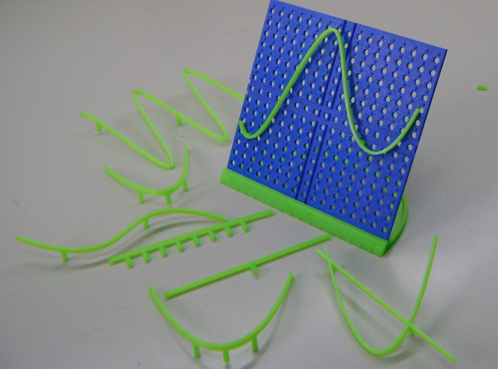
</p>

## Resumen

JUDITH es un dispositivo de asistencia a la enseñanza y al aprendizaje de funciones matemáticas, pensado principalmente para estudiantes con discapacidad visual. Consiste en un tablero perforado que representa el plano cartesiano y en un conjunto de piezas flexibles que representan funciones y se encajan en el tablero en puntos exactos. El diseño permite que la persona no solo *lea* un gráfico con los dedos, sino que lo *construya* a partir de una tabla de valores y verifique sus propiedades.

El dispositivo nació en el taller de matemática del Curso de Aprestamiento Universitario (CAU) de la Universidad Nacional de General Sarmiento (UNGS), donde se utiliza en clases regulares, y su uso puede extenderse a otros niveles educativos. Todas las piezas se publican en este repositorio para su descarga libre e impresión en cualquier impresora 3D de escritorio.

**Palabras clave:** tecnología de asistencia, percepción háptica, diseño universal, discapacidad visual, enseñanza de la matemática, funciones, impresión 3D, hardware abierto.

## Contenido

1. [Motivación](#motivación)
2. [Marco conceptual](#marco-conceptual)
3. [Metodología de diseño](#metodología-de-diseño)
4. [Descripción del dispositivo](#descripción-del-dispositivo)
5. [Uso en el aula](#uso-en-el-aula)
6. [JAIME: extensión a áreas y perímetros](#jaime-extensión-a-áreas-y-perímetros)
7. [Fabricación](#fabricación)
8. [Alternativas de bajo costo](#alternativas-de-bajo-costo)
9. [Transferencia y formación docente](#transferencia-y-formación-docente)
10. [Estructura del repositorio](#estructura-del-repositorio)
11. [Cómo citar](#cómo-citar)
12. [Referencias](#referencias)
13. [Licencia y contacto](#licencia-y-contacto)

## Motivación

El proyecto surge de una situación concreta: la incorporación de una estudiante ciega a una comisión de unos 45 estudiantes del curso de aprestamiento en matemática de la UNGS, avisada con un fin de semana de anticipación. El material disponible en la biblioteca de la universidad se reducía a una regla, una escuadra y un transportador, mientras que el libro del curso, *Matemática en contexto*, está construido —como casi todos los textos de matemática— sobre gráficos y figuras.

El braille y los lectores de pantalla resuelven el acceso al **texto**, pero no a la información que vive en el dibujo: curvas, ejes, intersecciones y regiones sombreadas. A partir de esa barrera se fijaron tres condiciones de trabajo:

| Condición | Significado |
|---|---|
| **Al mismo tiempo** | La enseñanza y el aprendizaje son sincrónicos, en la misma clase que el resto. |
| **En la misma aula** | Sin aula aparte ni curso paralelo: estudiantes ciegos y videntes comparten el espacio. |
| **Con la misma evaluación** | El mismo examen para todo el curso; solo cambia la forma de acceder. |

La necesidad, detectada a nivel institucional, dio origen a un proyecto de investigación en el Instituto de Industria (IDEI) de la UNGS.

## Marco conceptual

**Tecnología de asistencia específica.** Se entiende por tal el diseño y la fabricación de dispositivos de apoyo a la enseñanza y el aprendizaje de determinados contenidos, en ciertos espacios curriculares, para estudiantes ciegos de todos los niveles educativos. A diferencia de la tecnología de asistencia general (lectores de pantalla, impresoras braille, bastones), que da acceso amplio pero superficial, la específica da acceso a un concepto en profundidad.

**Percepción háptica.** Conjunto de sensaciones no visuales que experimenta una persona para recibir información; un sistema de procesamiento de la información a través del tacto que las personas ciegas utilizan para relacionarse con el mundo que las rodea (Carranza et al., 2019).

**Diseño universal.** Productos y entornos utilizables por todas las personas en la mayor medida posible, sin necesidad de adaptaciones ni diseños especializados (Mace, 1989).

De la combinación de ambos conceptos surge el principio rector del proyecto: *un dispositivo pensado para la necesidad de la estudiante ciega, pero útil para todo el curso.*

**Antecedentes.** El relevamiento previo encontró recursos valiosos y de muy bajo costo (escarbadientes y plastilina, alfileres sobre un círculo punteado, tableros táctiles combinados), pero en general pensados para el nivel escolar, de uso puntual y sin vínculo con el programa de un curso universitario real.

## Metodología de diseño

El trabajo experimental se organizó en dos fases:

- **Fase 1, laboratorio.** Diseño y fabricación del dispositivo: texturas, tamaños, materiales y tolerancias. Pregunta guía: *¿funciona como objeto?*
- **Fase 2, con usuarios.** La estudiante ciega lo usa en clases reales e indica qué ayuda y qué no. Pregunta guía: *¿funciona como herramienta de aprendizaje?*

El aprendizaje central del proceso es que la estudiante no es alguien que prueba al final: es **co-diseñadora** desde el primer prototipo.

### Del primer prototipo al rediseño

El primer diseño fue una curva en relieve sobre una cuadrícula. La evaluación de la usuaria arrojó:

| Criterio | Resultado |
|---|:---:|
| Textura | ✔ |
| Tamaño | ✔ |
| Tacto asociado al concepto matemático | ✔ |
| Identificación de los ejes | ✔ |
| Crecimiento / decrecimiento | ✔ |
| Dónde la curva corta los ejes | ✘ |
| Identificación de las unidades | ✘ |

El problema de fondo era que se trataba de una maqueta *estática*: servía para una clase, a lo sumo un par. De cada resultado negativo y de las palabras de la propia estudiante surgieron los requisitos del rediseño:

- unidades que la usuaria pueda identificar claramente;
- una unidad arbitraria, como en el papel;
- funciones que se puedan intercambiar;
- funciones que la estudiante pueda construir;
- manos libres: que el tablero se sostenga solo;
- un arriba y un abajo claros;
- un tamaño adecuado a la palma de la mano;
- durable, reproducible y compartible.

### Ciclo de construcción

1. Elegir un ejercicio del curso real.
2. Traducir lo visual al tacto.
3. Modelarlo (Tinkercad, gratuito).
4. Imprimirlo o construirlo.
5. Probarlo con la estudiante y, según el resultado, volver al paso 2.

Las reglas de traducción empleadas son: línea → relieve; punto → perno; unidad → agujero; sombreado → textura; eje → una pieza distinta y fija.

## Descripción del dispositivo

<p align="center">
  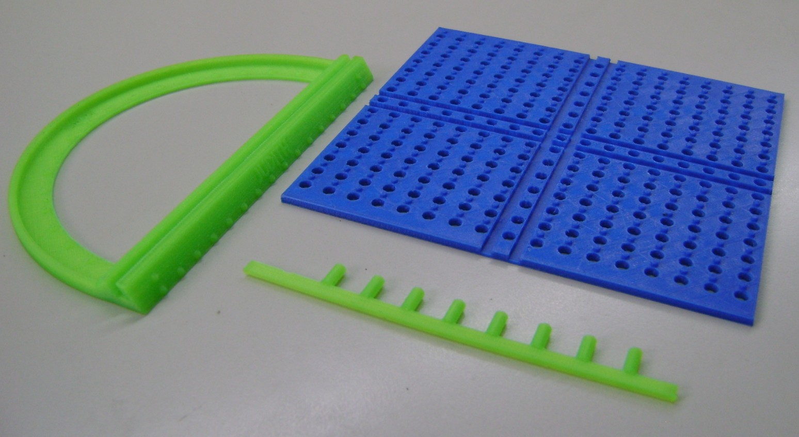
</p>

| Componente | Función |
|---|---|
| **Tablero** | Plano modular perforado. Cada agujero es una unidad, lo que permite contar posiciones desde el origen. |
| **Soporte** | Mantiene el tablero en posición vertical y deja las dos manos libres para explorar. |
| **Piezas de funciones** | Curvas flexibles con pernos que encajan en los agujeros en puntos exactos; son intercambiables. |

### Anverso y reverso

<p align="center">
  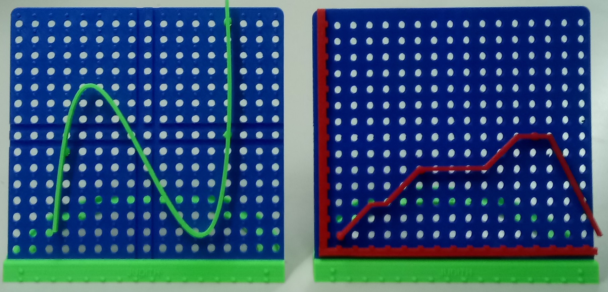
</p>

El tablero tiene dos caras de trabajo. En el **anverso** los ejes están en el centro y se dispone de los cuatro cuadrantes. En el **reverso** los ejes están en los bordes y se trabaja solo en el primer cuadrante, lo que resulta adecuado para problemas en contexto, como los gráficos de tiempo–distancia.

### De la tabla de valores al tablero

<p align="center">
  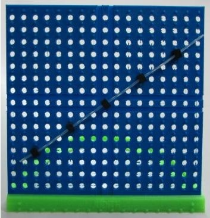
</p>

1. La estudiante calcula una tabla de valores.
2. Cuenta agujeros desde el origen y ubica un marcador en cada punto.
3. Apoya una pieza recta sobre los marcadores.
4. Comprueba con los dedos si los puntos están alineados: ¿es realmente lineal?

La estudiante no recibe un gráfico terminado: lo construye.

## Uso en el aula

### Secuencia didáctica en cuatro momentos

<p align="center">
  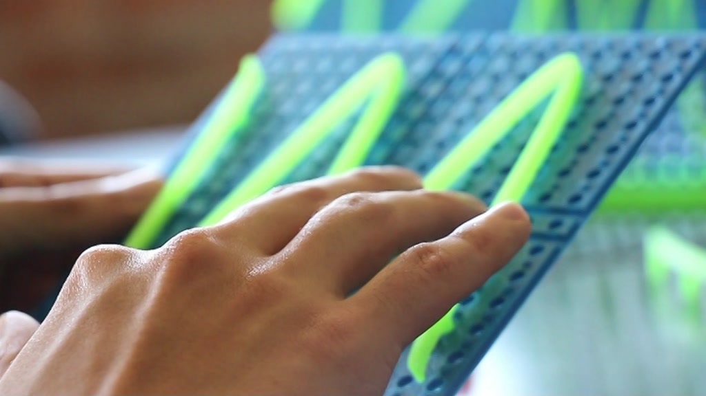
  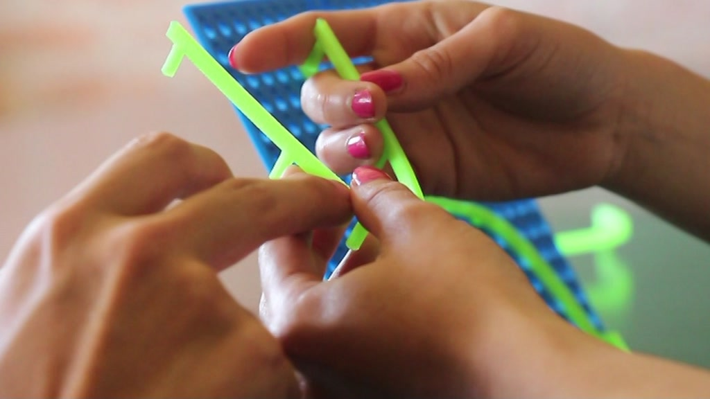
</p>

Plan de clase de unos 50 minutos para una pareja formada por un estudiante ciego y uno vidente:

| Momento | Tiempo | Consigna |
|---|:---:|---|
| **1. Explorar** | 10 min | Exploran la misma función, uno en JUDITH y otro en el libro: crecimiento, raíces, máximos y mínimos. |
| **2. Reconocer las piezas** | 5 min | La estudiante ciega identifica pernos, curvas y ejes; el compañero los nombra en el dibujo. |
| **3. Ubicar los puntos** | 15 min | El compañero lee una tabla de valores; ella cuenta agujeros y ubica cada punto. Luego intercambian roles. |
| **4. Construir y verificar** | 15 min | Encajan la curva, comprueban con el tacto y comparan con el gráfico impreso. |
| **Cierre** | 5 min | Puesta en común: dominio, imagen, raíces y conjuntos de positividad y negatividad. |

- **Objetivo:** construir una función a partir de sus puntos y leer sus propiedades, con el tacto y con la vista.
- **Evaluación:** la misma consigna escrita para todo el curso; solo cambia el acceso al gráfico.

### Ejemplo: exploración autónoma de una función

Sobre una función montada en el tablero, la estudiante:

1. encuentra el origen, donde se cruzan los dos ejes;
2. recorre la curva de punta a punta y obtiene el dominio, [−8; 5];
3. cuenta agujeros donde la curva toca el eje *x* y obtiene las raíces, {−6; −2; 2; 4};
4. ubica el punto más bajo y el más alto y obtiene la imagen, [−5; 6];
5. reconoce los intervalos de crecimiento y decrecimiento según los dedos suban o bajen;
6. determina el conjunto de positividad, [−8; −6) ∪ (−2; 2) ∪ (4; 5], y el de negatividad, (−6; −2) ∪ (2; 4), según la curva quede arriba o abajo del eje *x*.

### Estudio cotidiano

<p align="center">
  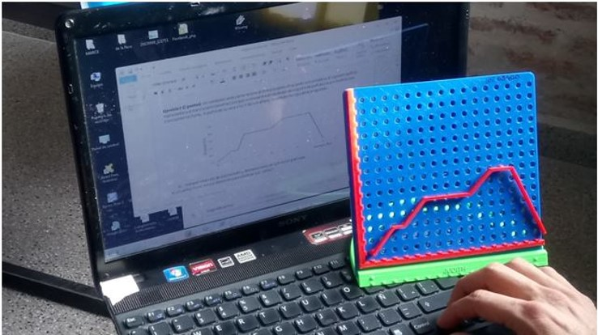
</p>

El lector de pantalla lee el enunciado del ejercicio y el tablero muestra el gráfico al que se refiere: texto por el oído, gráfico por el tacto. La estudiante trabaja sin esperar a que alguien le describa la figura.

### Aprendizaje colaborativo

Se sugiere el trabajo en parejas con roles de **constructor/a** (arma la función en el tablero) y **lector/a** (lee en voz alta los datos del libro o de la tabla); ambos responden las preguntas, comparan resultados e intercambian roles. Los estudiantes videntes también se benefician: construir un gráfico punto por punto vuelve físicos conceptos como raíces o intervalos. La estudiante ciega no es «ayudada»: aporta al grupo.

### Materiales escritos accesibles

Los dispositivos resuelven el gráfico; el texto y las fórmulas requieren su propia solución. Se recomienda redactar los apuntes en LaTeX y exportarlos a HTML para que un lector de pantalla (por ejemplo, JAWS) lea las fórmulas correctamente, y evitar fórmulas pegadas como imagen.

## JAIME: extensión a áreas y perímetros

<p align="center">
  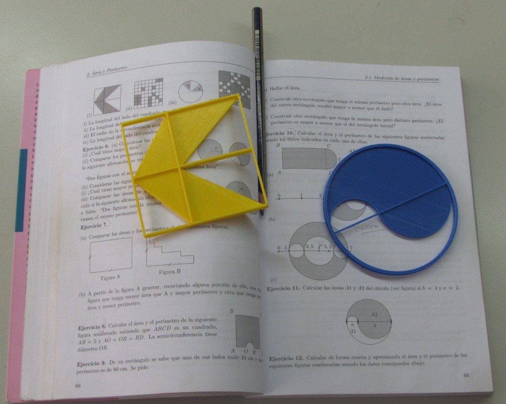
</p>

JAIME (*Juego de Áreas Impresas para Matemática Elemental*) aplica el mismo método a la geometría. Cada figura del libro se convierte en un marco impreso en 3D, y el sombreado se convierte en textura: la región sombreada se siente distinta de la vacía. Las piezas se pueden sacar y comparar.

**Ejemplo.** En el ejercicio del círculo inscripto en un cuadrado, con radio de 10 m, la estudiante percibe el cuadrado y el círculo, reconoce las esquinas con textura como la región sombreada, retira el círculo para comprobar que el lado del cuadrado es igual al diámetro (20 m) y calcula:

A = 20² − π · 10² = 400 − 100π ≈ 85,8 m²

El mismo ejercicio, el mismo libro y el mismo resultado que el resto del curso.

## Fabricación

Las piezas fueron diseñadas en [Tinkercad](https://www.tinkercad.com) y pueden imprimirse en cualquier impresora 3D de escritorio.

1. Descargar o clonar el repositorio:
   ```bash
   git clone https://github.com/maxiveliz/JUDITH.git
   ```
2. Imprimir el tablero (carpeta `Tablero impreso`).
3. Imprimir el soporte (carpeta `Soporte tablero impreso`).
4. Imprimir las piezas de funciones que se necesiten (carpeta `funciones STL`).

Se recomienda usar colores contrastantes entre el tablero y las piezas, lo que favorece a estudiantes con baja visión y al trabajo conjunto con estudiantes videntes.

## Alternativas de bajo costo

Sin impresora 3D, el dispositivo puede reproducirse con materiales corrientes:

| Elemento | Opciones |
|---|---|
| **Tablero** | Plancha de corcho o telgopor con una cuadrícula impresa; panel perforado de ferretería; cartón grueso con un agujero en cada unidad. |
| **Curvas** | Chinches con elásticos o lana; hilo encerado o limpiapipas; alambre moldeado; una línea de silicona caliente sobre cartulina. |
| **Áreas** | Recortes de goma EVA o cartón; lija, tela o malla como «sombreado»; escarbadientes y plastilina para polígonos. |

Lo importante no es el material, sino las reglas: unidades que se puedan contar, ejes que se puedan distinguir, puntos que queden fijos y piezas que se puedan cambiar.

## Transferencia y formación docente

<p align="center">
  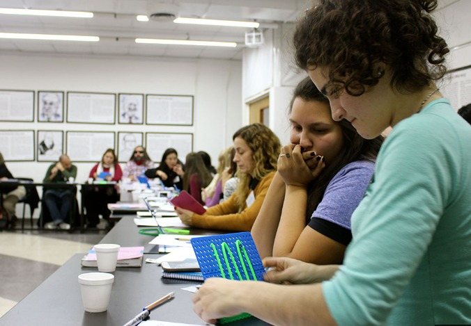
  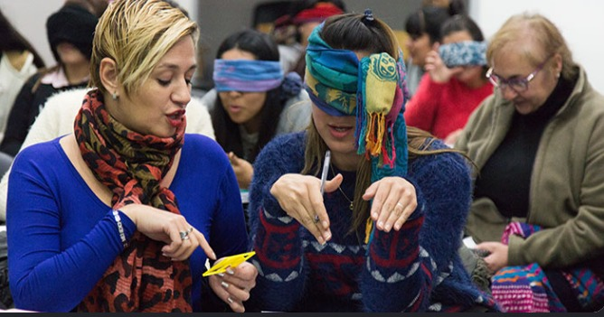
</p>

Las jornadas-taller *Matemática con los dedos* proponen a los docentes tres instancias: **vivir la barrera** (con los ojos vendados se descubre qué se pierde sin la vista), **explorar en pareja** (uno explora con el tacto y el otro guía con palabras) y **llevarlo al aula** (cada jornada cierra con propuestas de uso en clase). Entre las actividades se cuentan la búsqueda táctil del punto de intersección de dos funciones, como forma concreta de abordar sistemas de ecuaciones, y la lectura de subidas, bajadas, máximos y mínimos de una curva.

<p align="center">
  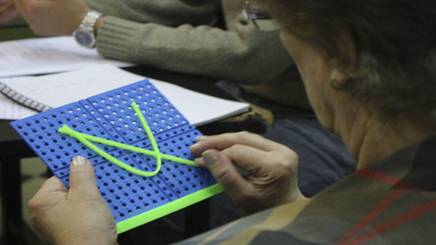
  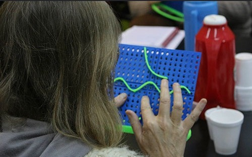
  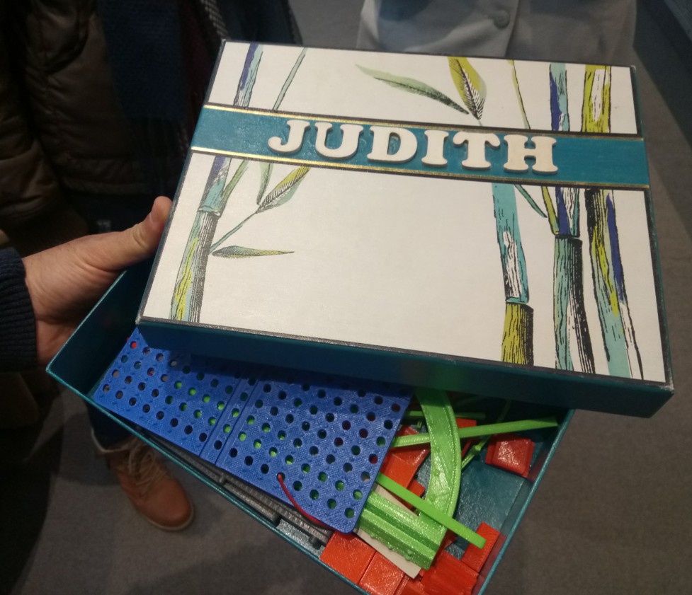
</p>

Jornadas-taller y adquisición del kit en Argentina:

- Universidades nacionales: General Sarmiento, Hurlingham, Arturo Jauretche, Río Cuarto, Quilmes, Santiago del Estero, Tierra del Fuego y Buenos Aires.
- Universidad Tecnológica Nacional (Regionales Buenos Aires y Avellaneda).
- Biblioteca Argentina para Ciegos.
- Formación docente: Escuela Normal Superior de Monteros, Tucumán.
- Jornada Argentina de Tiflología y Congreso Argentino de Educación Matemática.
- Kit en préstamo en una biblioteca popular de Villa María, Córdoba.

### Seis pasos para reproducir la experiencia

1. **Partir de un estudiante real** y de un ejercicio real, no de un catálogo.
2. **Encontrar la barrera visual:** ¿qué información vive solo en el dibujo?
3. **Traducirla al tacto:** puntos, líneas, unidades, texturas.
4. **Construir barato y rápido:** primero cartón, después impresión 3D.
5. **Dejar que el estudiante evalúe** y rediseñar con él o ella.
6. **Usarlo con todo el curso** y compartir el diseño de forma abierta.

## Estructura del repositorio

```
JUDITH/
├── Tablero impreso/                 Modelos del tablero (plano cartesiano perforado)
├── Soporte tablero impreso/         Modelos del soporte vertical
├── funciones STL/                   Piezas de funciones (rectas, parábolas, polinomios, etc.)
├── Diseño de dispositivos matemáticos accesibles.pdf    Presentación del proyecto
├── Matemática_en_contexto-completo.pdf                  Libro del curso (UNGS)
├── LICENSE
└── README.md
```

## Cómo citar

Si utiliza JUDITH en docencia o investigación, se sugiere citar el repositorio:

> Véliz, M. E. *JUDITH: Juego Didáctico para Tareas Hápticas* [hardware abierto]. GitHub. https://github.com/maxiveliz/JUDITH

```bibtex
@misc{veliz_judith,
  author       = {Véliz, Maximiliano E.},
  title        = {{JUDITH}: Juego Didáctico para Tareas Hápticas},
  howpublished = {\url{https://github.com/maxiveliz/JUDITH}},
  note         = {Hardware abierto, licencia MIT}
}
```

## Referencias

- *Un dispositivo para hacer Matemática con los dedos.* Disponible en [ResearchGate](https://www.researchgate.net/publication/305490661_Un_dispositivo_para_hacer_Matematica_con_los_dedos).
- Carranza et al. (2019). *Revista Argentina de Bioingeniería.*
- Mace, R. (1989). Concepto de diseño universal.
- Carnelli, G., Cesaratto, E., Falsetti, M., Formica, A. y Marino, T. *Matemática en contexto.* Universidad Nacional de General Sarmiento. Disponible en [ediciones.ungs.edu.ar](https://ediciones.ungs.edu.ar).
- Véliz, M. E. (2026). *Diseño de dispositivos matemáticos accesibles: de la necesidad de una estudiante ciega a una herramienta que funciona* [presentación]. Incluida en este repositorio.

### Recursos

- Herramienta de diseño 3D gratuita: [tinkercad.com](https://www.tinkercad.com)
- Lector de pantalla JAWS: [freedomscientific.com/products/software/jaws](https://www.freedomscientific.com/products/software/jaws)

## Licencia y contacto

Este proyecto se distribuye bajo licencia [MIT](LICENSE).

**Prof. Ing. Maximiliano E. Véliz, PhD**
Instituto de Industria (IDEI), Universidad Nacional de General Sarmiento (UNGS)
Secretaría de Investigación, Universidad Nacional de Hurlingham (UNAHUR)

- mveliz@campus.ungs.edu.ar
- maximiliano.veliz@unahur.edu.ar
